<h1 align="center">All Asmaul Husnain · Mugdho</h1>

  <strong>CS Student · Future AI Engineer · Builder</strong> 
  I build practical software, study computer science, and contribute to open source. 
  Open to internships and open source collaboration.

  <a href="https://github.com/MugdhoAI">GitHub</a>
  ·
  <a href="https://www.linkedin.com/in/mugdhoai/">LinkedIn</a>
  ·
  <a href="mailto:allasmaulhusnain715@gmail.com">Email</a>

<table>
  <tr>
    <td width="46%" valign="top">
      
    </td>
    <td width="54%" valign="top">
      
    </td>
  </tr>
</table>

  

<h3 align="center">Tech Stack</h3>

   
  

  C · C++ · Python · Databases · Search · AI and ML · Open source

## Top projects

### [SQLite in C](https://github.com/MugdhoAI/sqlite-c)
A relational database engine built from scratch in C11, inspired by SQLite. Its own file format with 4096 byte pages, a B tree with leaf splits, a SQL parser, and an interactive shell for INSERT and SELECT. Automated tests, a 1,000 row insert benchmark, and CI with AddressSanitizer and UndefinedBehaviorSanitizer. Educational, and not compatible with SQLite database files.

### [Search Engine](https://github.com/MugdhoAI/search-engine)
A search engine built from scratch in Python. An inverted index answers AND, OR, and quoted phrase queries, ranked by TF-IDF with deterministic results. CLI and web app, JSON persistence, and CI across Python 3.11 to 3.13.

### [ImportGuard](https://github.com/MugdhoAI/ImportGuard)
A review-first CSV mapping and validation workspace, shipped and live. Import a CSV, map its columns to a target schema, validate every row against deterministic rules, and export clean data, with human approval before anything is final. Built on a FastAPI backend, entered in the Meta Global AI Developer Hackathon, and released as v1.0.0. Live demo: [importguard.onrender.com](https://importguard.onrender.com).

### [Vault API](https://github.com/MugdhoAI/vault-api)
A FastAPI REST API for storing secrets, built to learn backend security properly. Argon2 password hashing, Fernet encryption at rest, JWT access tokens, and secrets scoped to their owner, with audit events and PostgreSQL integration tests. A learning project, not production ready.

## Focus

I build reliable software and study computer science, working toward AI engineering. My ground is systems and databases in C, search and ranking algorithms, and Python backend engineering, and I learn in the open by contributing to real codebases.

## Open source

**98 pull requests merged** across open source projects. I contribute by learning the surrounding implementation, solving concrete issues, adding tests, and responding to maintainer feedback. A few examples:

| Contribution | What I worked on |
| --- | --- |
| [Soup #1243](https://github.com/MakazhanAlpamys/Soup/pull/1243) · **merged** | Fixed Transformers 5 BatchEncoding handling in sequence distillation and added regression coverage |
| [Soup #1053](https://github.com/MakazhanAlpamys/Soup/pull/1053) · **merged** | Fixed Rich markup handling for model names supplied by users and added regression coverage |
| [Provena #182](https://github.com/rajfirke/provena/pull/182) · **merged** | Added regression coverage for CLI commands available at the top level exposed in help output |
| [cubrid-mcp-server #1](https://github.com/MugdhoAI/cubrid-mcp-server/pull/1) · **merged** | Fixed SQL comment handling in audit categorization with regression coverage |
| [pycubrid #378](https://github.com/cubrid-lab/pycubrid/pull/378) · **merged** | Added strict positive integer validation for Cursor.arraysize across sync and async cursors |

  The contribution city above is drawn from my real GitHub activity and refreshed daily by a generator I built: every building is a day, taller buildings mean more contributions, and quiet days stay parks.

